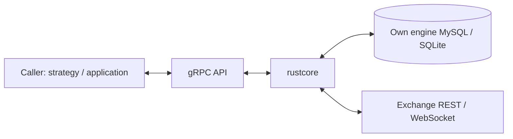

# rustcore

[](https://github.com/svip2025/rustcore/actions/workflows/ci.yml)

A standalone trading execution kernel for orders, positions, protective orders, reconciliation, risk admission, and kill switches, exposed through gRPC.

**For education, paper trading, and exchange testnets only. This is experimental software, not financial software or financial advice. It comes with no warranty. Do not entrust real funds to it.** See [LICENSE](LICENSE).

## Architecture



The kernel owns its engine database. It does not query the caller's database, run strategies, call language models, or send telemetry. Its normal outbound network connections are to the exchange; an optional operator-configured egress identity probe is a separate opt-in connection. Paper execution needs no exchange credentials; public exchange market data is optional.

The implementation includes a paper order manager and a Binance USDⓈ-M futures adapter. SQLite is available for local execution; the test setup below also exercises real MySQL behavior.

## Quickstart

Prerequisites: Linux or WSL on a Linux filesystem, a recent Rust toolchain with `rustfmt` and `clippy`, a C/C++ build toolchain, and Docker with Compose. Protobuf compilation uses the pinned `protoc-bin-vendored` dependency; no system `protoc` installation is needed.

```bash
git clone https://github.com/svip2025/rustcore.git
cd rustcore
docker compose up -d
cargo test
```

Compose starts an isolated MySQL server on `127.0.0.1:13306`; tests create and migrate their scratch databases automatically.

`cargo test` should report about **1,390 passing tests**; a cold build and test run on an 8-core machine takes about **10 minutes**.

30 tests are ignored: subprocess helpers and integration scenarios requiring an external application or fixture. See [Testing](docs/TESTING.md) for details.

Check formatting and lints with:

```bash
cargo fmt --check
cargo clippy -- -D warnings
```

Stop the disposable fixture (its scratch data is removed):

```bash
docker compose down
```

## Run safely

```bash
cargo run --locked
```

The server binds to `127.0.0.1:50051`, uses `sqlite://./data/rustcore.db`, and automatically creates its database and applies migrations. With no live authorization or exchange credentials, execution is paper-only. Public exchange connections default to testnet. See [.env.example](.env.example) for placeholder settings; the process reads environment variables, so export values explicitly when using a file.

Mainnet requires an explicit `ENGINE_LIVE_ENABLED=1` opt-in and produces a prominent startup warning. That switch alone does not authorize an order: stage limits, matching nonexpired promotion certification, credentials, and normal admission checks still apply. Before live orders, the caller must publish an unexpired stage certification confirming that the strategy has passed its paper/testnet stage. No mainnet configuration example is supplied.

For a MySQL-backed engine, set `RUSTCORE_DB_URL` to your own engine database URL. `RUSTCORE_TEST_MYSQL_URL` is a separate scratch-database setting and is not the engine runtime database.

### Authentication and TLS

A non-loopback bind requires a token unless authentication is explicitly disabled. Use `RUSTCORE_GRPC_AUTH_TOKEN` or the comma-separated rotation list `RUSTCORE_GRPC_AUTH_TOKENS`, and send `authorization: Bearer <token>` metadata. A configured token is also enforced on loopback. Never expose an unauthenticated listener.

TLS uses `RUSTCORE_GRPC_TLS_CERT_PATH` and `RUSTCORE_GRPC_TLS_KEY_PATH`. Add `RUSTCORE_GRPC_TLS_CLIENT_CA_PATH` to require client certificates. Invalid or incomplete TLS configuration fails startup.

### Credential isolation

Exchange settings can be scoped with `BINANCE_VENUE_<LOCATOR>`, `BINANCE_API_KEY_<LOCATOR>`, and `BINANCE_API_SECRET_<LOCATOR>`. The locator is `H` followed by the uppercase hexadecimal encoding of the trimmed credential identifier's UTF-8 bytes. This is an injective encoding: punctuation differences in credential identifiers cannot accidentally share a key.

An explicitly selected venue determines both REST and WebSocket endpoints. Conflicting endpoint overrides are rejected, and explicitly scoped credentials do not fall back to global keys. Keep secrets outside the repository and never reuse a mainnet key for testnet experiments.

## Safety invariants and executable examples

These tests demonstrate specific boundaries; they are not a proof that every exchange or failure mode is safe. Reduce-only exits remain subject to valid identity, exchange availability, and exchange-enforced bans.

| Invariant | Test name | Source |
| --- | --- | --- |
| Kill-switch admission levels preserve reduce-only close and protective intents. | `all_kill_switch_levels_allow_reduce_only_close_and_sl_tp_protection_orders` | [src/svc.rs](src/svc.rs) |
| A stale risk budget rejects new exposure while allowing reduce-only close. | `risk_budget_freshness_dod_rejects_stale_open_but_allows_reduce_only_close` | [src/svc.rs](src/svc.rs) |
| A non-idempotent write that requires verification selects truth lookup rather than blind retry. | `non_idempotent_write_returns_truth_lookup_not_retry` | [src/rate_limiter.rs](src/rate_limiter.rs) |
| An unknown exchange outcome keeps the exit unresolved. | `an_unknown_exchange_outcome_must_not_release_the_exit` | [src/svc.rs](src/svc.rs) |
| Retrying an exact paper position close is idempotent and leaves other positions unchanged. | `wire_exact_close_is_idempotent_and_other_positions_are_unchanged` | [src/position_close_tests.rs](src/position_close_tests.rs) |
| Read retries honor rate limits; an IP ban engages cooldown without retry. | `rate_limit_429_retries_read_but_418_never_retries_and_engages_cooldown` | [src/binance_futures.rs](src/binance_futures.rs) |
| The file kill switch latches; deleting its file does not reset it. | `kill_switch_file_is_latched_within_poll_window_and_delete_does_not_reset` | [src/kill_switch.rs](src/kill_switch.rs) |
| Failure to submit protection after an entry fill requests flattening and prevents a ready state. | `an_entry_fill_whose_protection_submit_fails_latches_flatten_and_not_ready` | [src/svc.rs](src/svc.rs) |

Run one example by its unique test-name suffix:

```bash
cargo test all_kill_switch_levels_allow_reduce_only_close_and_sl_tp_protection_orders
```

## gRPC API

The server registers both contracts. Generate clients from the checked-in proto files; protobuf declarations alone do not mean that every RPC is implemented.

| Contract | Main implemented RPCs |
| --- | --- |
| [v2 execution](proto/execution_engine_v2.proto) | `ExecuteIntents`, `ReconcileNow`, `GetAccountState`, `GetAccountOrderState`, `GetPositionStates`, `GetOrderByClientOrderId`, `ReleasePending` |
| v2 position close | `GetPositionCloseTarget`, `ClosePosition`, `GetPositionCloseReceipt` |
| v2 control and recovery | `FundSimulationAccount`, `PutRiskBudget`, `PutPromotionCertification`, `SetKillSwitch`, `ResetKillSwitch`, `GetKillSwitchStates`, `AdmitMemberReset`, `ArmLifecycleFence`, `GetLifecycleFence` |
| [vNext execution](proto/execution_engine_vnext.proto) | `ExecuteIntents`, `GetOrder`, `GetOpenOrders`, `CancelOrder`, `ReconcileNow`, `EnsureMarketData` |
| vNext events | `EngineEvents.StreamEvents` with sequence-based replay and tailing |

The v2 `GetOrder`, `GetOpenOrders`, `CancelOrder`, `EnsureMarketData`, and `EngineEvents.StreamEvents` currently return `UNIMPLEMENTED`; use their vNext counterparts where needed. Exact position close has explicit availability and ownership checks; an unavailable target must not be treated as permission to close another position.

`GetAccountState` requires `credential_id`. Its optional `bot_uid` filters positions, while account totals remain credential-wide. Missing balance truth returns `available=false` without invented monetary values. `as_of_ms` is the older balance/position timestamp, and missing liquidation prices remain absent. The response identifies derived fields such as equity and used margin; these are not direct exchange fields. This read path does not grant order or flatten admission.

## Caller responsibilities

1. **Intent provenance.** Supply `bot_uid`, `run_id`, `cycle_id`, `intent_id`, `idempotency_key`, `policy_version`, `config_hash`, `prompt_hash`, and `code_commit`, plus the batch's `DataSnapshotDecision`. The kernel checks format and consistency; it does not query an external provenance database.
2. **Current risk budget.** Periodically publish account budgets using `PutRiskBudget`. A budget older than `RISK_BUDGET_MAX_AGE_MS` (30 seconds by default) blocks new exposure. Budget freshness does not itself block reduce-only exits, protection, or reconciliation.
3. **Market data.** Call the vNext `EnsureMarketData` RPC for required instruments. Paper accounts can use public mark-price data without exchange credentials; callers must still handle missing or stale prices.
4. **Simulation funding.** Fund `paper` or `paper:<32 lowercase hexadecimal characters>` credentials through `FundSimulationAccount`, with a stable idempotency identity. Do not fund an exchange credential through this API.
5. **Authorization and certification.** Authenticate users, authorize account membership and bot bindings, enforce operator challenges, and publish valid promotion certification when appropriate. Environment switches do not replace those responsibilities.
6. **Recovery and freshness.** Treat missing, stale, partial, and unknown results explicitly. Deduplicate streamed events by `(seq, event_id)` and resume with `since_seq`. Do not interpret a submission acknowledgment as an exchange fill or a local protective-order row as confirmed exchange protection.
7. **Deployment ownership.** Assign one exchange gateway owner per network egress route and use the engine's own database for durable state. Independent processes must not each assume they own the same exchange IP weight budget.

## Design tradeoffs

- **Existence is not effectiveness.** A persisted order or protective plan records an obligation. Only observed exchange truth can confirm its effect; missing confirmation stays unknown and recovery remains pending.
- **Read back uncertain writes.** A timed-out request may already have reached the exchange. Retaining identity and querying truth avoids creating a second order through a blind retry.
- **Real databases for lifecycle boundaries.** Transaction visibility, connection return, cancellation, and restart behavior need real SQLite/MySQL coverage. Scripted venues still isolate exchange response scenarios without placing real orders.
- **Admission gates preserve recovery.** New risk is rejected when budgets or recovery truth are unfit, while valid reducing and protective actions retain their own routes. This cannot override exchange downtime, an IP ban, or missing authority.
- **Small execution boundary.** Strategies, user management, provenance storage, and certification publication belong to callers. The kernel validates supplied facts and owns its execution state.

## Repository and dependencies

| Path | Purpose |
| --- | --- |
| `src/` | gRPC services, execution, risk, recovery, and exchange adapters |
| `migrations/` | Engine database migrations, applied automatically |
| `proto/` | Versioned gRPC wire contracts |
| `crates/ai-trade-contracts/` | Committed shared contract types and fixtures |
| `crates/risk-policy/` | Factory risk policy and its content hash |
| `tests/` | Process, transport, and real-database scenarios |
| `vendor/sqlx-core-0.8.6/` | Pinned SQLx connection-pool lifecycle patch |

Only `sqlx-core` 0.8.6 is vendored. The patch bounds dropped-connection return, discards connections with unknown state, and makes concurrent pool closers wait for real resource release. It does not claim that a whole pool always closes in five seconds. Other SQLx crates come from crates.io. See [PATCHES.md](vendor/sqlx-core-0.8.6/PATCHES.md) for provenance and removal conditions. The upstream [MIT](vendor/sqlx-core-0.8.6/LICENSE-MIT) and [Apache-2.0](vendor/sqlx-core-0.8.6/LICENSE-APACHE) licenses are preserved.

The project is MIT-licensed. Dependency license policy is checked with:

```bash
cargo deny check licenses
```
